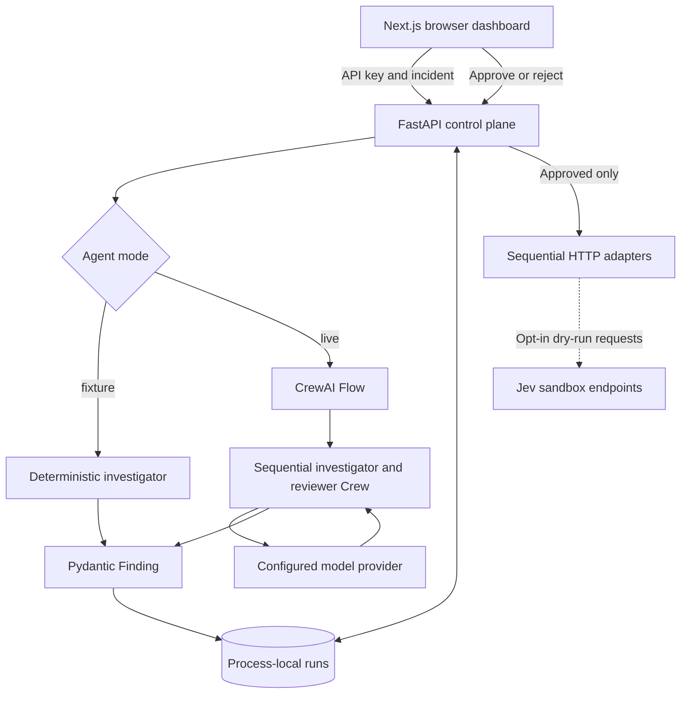
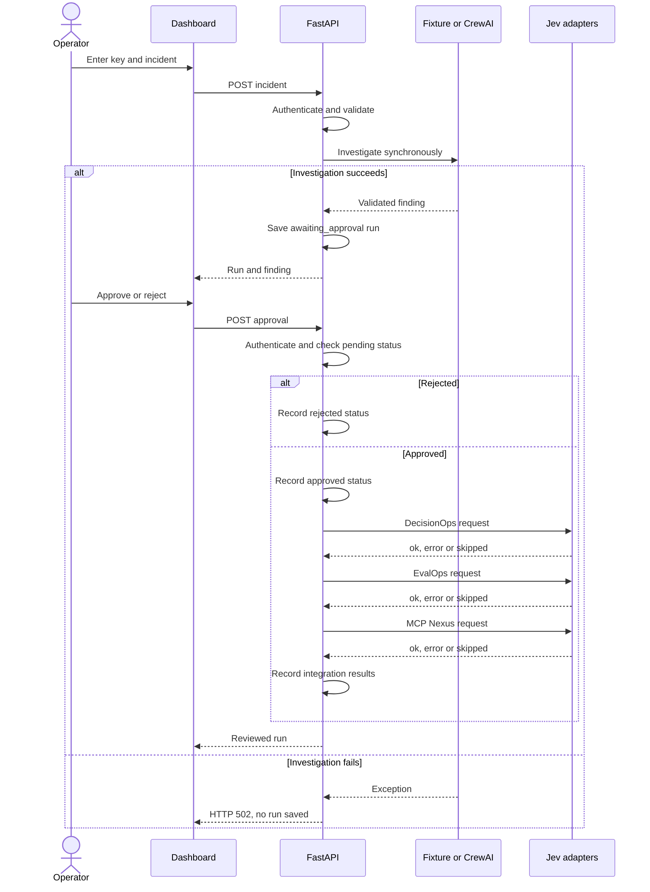
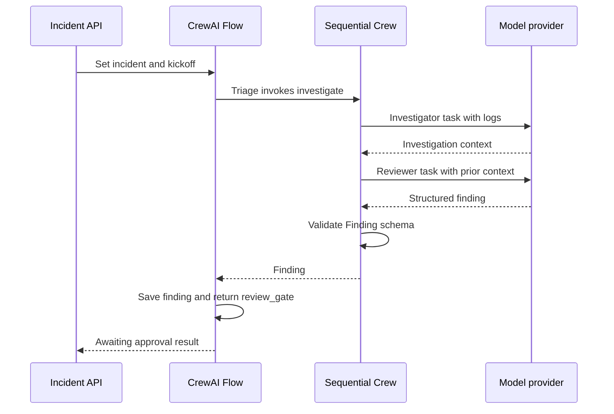
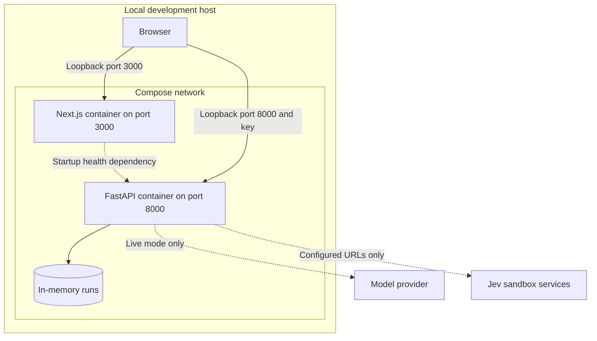
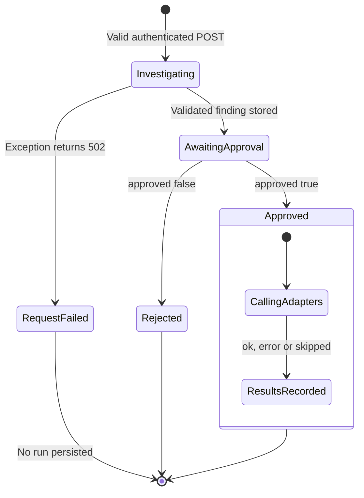
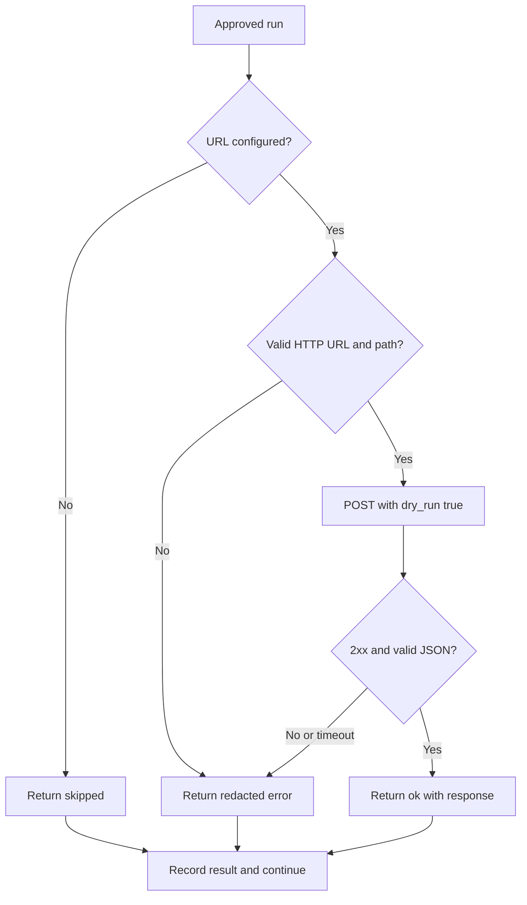
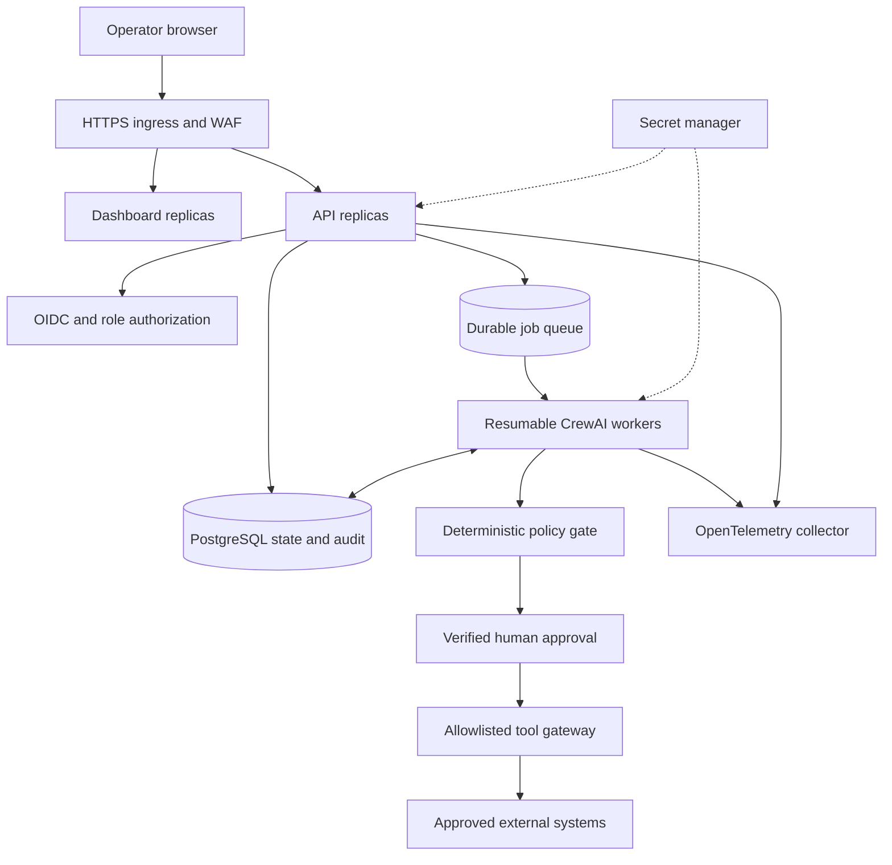

# System diagrams

Diagrams describe the checked-in implementation unless labeled future target. Real LLM inference, upstream interoperability and container deployment were not verified by local tests. No credential is bundled.

## 1. Component architecture

One API process investigates, stores state and handles review. Model calls occur only in live mode. Dotted external links represent unverified contracts.

## 2. Incident and approval sequence

Calls are sequential. An adapter error does not stop subsequent requests. Duplicate review returns 409. Successful approval HTTP response does not prove upstream success or tool execution.

## 3. Live CrewAI execution

The actual Flow was tested with inference stubbed. Provider traffic above is the intended live code path, not an observed transaction. The review gate does not durably suspend execution.

## 4. Current local deployment topology

The browser calls FastAPI directly, not through a Next.js proxy. Compose has no database, Redis, worker service or persistent workflow volume. Restarting the API loses all runs.

## 5. Implemented lifecycle

Only `awaiting_approval`, `approved` and `rejected` are persisted by the API. Investigating/request failure are transient request states. Nested approval stages represent trace/action progress, not additional Run status values. `executed` and `failed` are reserved schema values. Integration errors do not change approval status. Process failure can lose or interrupt every state.

## 6. Integration result handling

This applies independently to all three adapters. DecisionOps does not enforce an execution policy. A dry-run field cannot guarantee that a remote service avoids side effects.

## 7. Future production topology — not implemented

Production additionally requires distributed idempotency, retries, audit integrity, verified contracts, monitoring and dependency remediation. See [architecture gaps](ARCHITECTURE.md).
